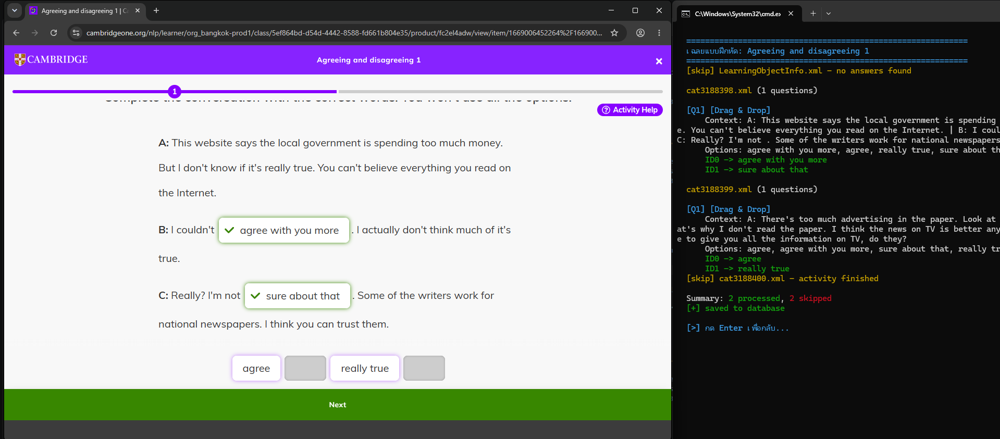

# Cambridge One Answer Extractor & Scraper 🎓✨



A tool designed to automatically extract answers from Digital Workbooks on the Cambridge One website. It operates using a real browser (via Playwright), features account and Chrome Profile management, a database caching system, and supports both English and Thai.

---

## 🇬🇧 English Documentation

### 🌟 Key Features
*   **Automated Extraction:** Fetches answer data from `data.js` files and decodes XML to display workbook answers.
*   **Account Management:** Saves emails and (optional) passwords, and creates separate Chrome Profiles for each account to maintain login sessions.
*   **Database Cache:** Saves extracted answers to `answers_db.json` to prevent redundant fetching and save time.
*   **Smart Cataloging:** Scans exercises within a unit, successfully collecting items even if the website uses lazy loading or virtual scrolling.
*   **Verification:** Verifies the exercise title and URL against the selected item before fetching to prevent mismatched answers.
*   **Multi-language Support:** User interface available in English and Thai.
*   **Logging:** Saves execution history to the `logs` folder for debugging purposes.

### 📋 Prerequisites
*   **Python:** Version 3.9 or higher is recommended.
*   **Required Libraries:**
    ```bash
    pip install playwright colorama
    ```
*   **Install Playwright Browsers:**
    ```bash
    playwright install chromium
    ```

### 🚀 How to Use
1.  Open Terminal or Command Prompt and run the script:
    ```bash
    python extractor.py
    ```
2.  Select menu `1` to go to the Login screen.
3.  Select an existing account or press `A` to add a new one.
4.  A browser window will open (if not logged in, please log in manually).
5.  Select the desired Course.
6.  Select the desired Unit.
7.  Select the exercise you want to view answers for (the program will scan and locate it).
8.  Wait for the program to fetch and display the answers on the Terminal screen.

### 📁 File Structure
*   `extractor.py` : Main program file.
*   `configs/` : Folder for configuration files.
    *   `settings.json` : Stores language preferences.
    *   `cambridge_accounts.json` : Stores account emails and passwords.
    *   `answers_db.json` : Database of previously extracted answers.
*   `chrome_data/` : Stores Chrome Profile data separated by account (to maintain sessions).
*   `logs/` : Folder for execution log files.

### ⚠️ Disclaimer
*   This program is created for educational purposes regarding automation scripting and web scraping only.
*   The developer is not affiliated with Cambridge University Press or Cambridge One.
*   Using this program for exploitation or violating the Terms of Service of the target website is the sole responsibility of the user.

---

## 🇹🇭 เอกสารภาษาไทย

### 🌟 ฟีเจอร์หลัก
*   **ดึงเฉลยอัตโนมัติ:** ดึงข้อมูลคำตอบจากไฟล์ `data.js` และถอดรหัส XML เพื่อแสดงผลเฉลยแบบฝึกหัด
*   **ระบบจัดการบัญชี:** บันทึก Email และรหัสผ่าน (แบบ Optional) พร้อมระบบแยก Chrome Profile สำหรับแต่ละบัญชี เพื่อรักษา Session การ Login
*   **ระบบฐานข้อมูล:** บันทึกเฉลยที่เคยดึงแล้วลงไฟล์ `answers_db.json` ช่วยให้ไม่ต้องดึงข้อมูลซ้ำ ช่วยประหยัดเวลา
*   **สแกนแบบฝึกหัด:** ระบบสแกนรายการแบบฝึกหัดในบทเรียน (Unit) แม้หน้าเว็บจะใช้ระบบ Lazy Load หรือ Virtual Scroll ก็สามารถรวบรวมรายการได้ครบถ้วน
*   **ตรวจสอบความถูกต้อง:** ตรวจสอบชื่อแบบฝึกหัดและ URL ให้ตรงกับที่เลือกจริง ก่อนทำการดึงข้อมูล ป้องกันการแสดงผลผิดข้อ
*   **รองรับ 2 ภาษา:** หน้าจอการใช้งานภาษาไทยและภาษาอังกฤษ (สลับได้)
*   **ระบบบันทึก Log:** บันทึกประวัติการทำงานลงโฟลเดอร์ `logs` เพื่อใช้ตรวจสอบข้อผิดพลาด (Debug)

### 📋 สิ่งที่ต้องมีก่อนใช้งาน
*   **Python:** แนะนำเวอร์ชัน 3.9 ขึ้นไป
*   **ไลบรารีที่ต้องติดตั้ง:**
    ```bash
    pip install playwright colorama
    ```
*   **ติดตั้ง Browser ของ Playwright:**
    ```bash
    playwright install chromium
    ```

### 🚀 วิธีการใช้งาน
1.  เปิด Terminal หรือ Command Prompt แล้วรันไฟล์:
    ```bash
    python extractor.py
    ```
2.  เลือกเมนู `1` เพื่อเข้าสู่หน้า Login
3.  เลือกบัญชีที่มีอยู่ หรือกด `A` เพื่อเพิ่มบัญชีใหม่
4.  โปรแกรมจะเปิดหน้าต่าง Browser ขึ้นมา (หากยังไม่ได้ Login ให้ทำการ Login ให้เรียบร้อย)
5.  เลือก Course (คอร์สเรียน) ที่ต้องการ
6.  เลือก Unit (บทเรียน)
7.  เลือกแบบฝึกหัดที่ต้องการดูเฉลย (โปรแกรมจะสแกนหาข้อมูลให้)
8.  รอโปรแกรมดึงข้อมูลและแสดงเฉลยบนหน้าจอ Terminal

### 📁 โครงสร้างไฟล์
*   `extractor.py` : ไฟล์โปรแกรมหลัก
*   `configs/` : โฟลเดอร์เก็บไฟล์ตั้งค่า
    *   `settings.json` : เก็บค่าภาษาที่เลือก
    *   `cambridge_accounts.json` : เก็บรายชื่อบัญชีและรหัสผ่าน
    *   `answers_db.json` : ฐานข้อมูลเก็บเฉลยที่ดึงมาแล้ว
*   `chrome_data/` : โฟลเดอร์เก็บข้อมูล Chrome Profile แยกตามบัญชี (เพื่อรักษา Session)
*   `logs/` : โฟลเดอร์เก็บไฟล์ Log การทำงาน

### ⚠️ ข้อควรระวัง
*   โปรแกรมนี้จัดทำขึ้นเพื่อวัตถุประสงค์ในการศึกษาการเขียนโปรแกรมอัตโนมัติ (Automation) และการวิเคราะห์โครงสร้างเว็บไซต์ (Web Scraping) เท่านั้น
*   ผู้พัฒนาไม่มีส่วนเกี่ยวข้องกับ Cambridge University Press หรือ Cambridge One
*   การใช้งานโปรแกรมนี้เพื่อแสวงหาประโยชน์หรือละเมิดข้อตกลงการใช้งาน (Terms of Service) ของเว็บไซต์ต้นทาง ถือเป็นความรับผิดชอบของผู้ใช้งานเอง

---
*Developed by z3nTr4ry*
